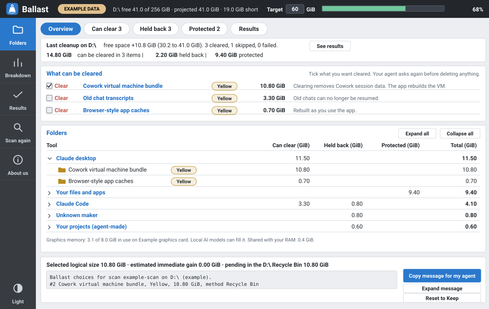

> Not legal advice. Not affiliated with, or endorsed by, any AI provider. Read [SAFETY.md](SAFETY.md) first.

Ballast is a set of plain-text instructions that your AI coding agent follows to find and clear the disk and memory
leftovers that AI tools leave behind: Claude Code and Claude desktop (chat and Cowork), Codex, Gemini, Antigravity, local
models (their files on disk, and the **GPU memory (VRAM)** they keep loaded), MCP servers, headless browsers, and the
scratch projects agents create.

The plugin contains Markdown instructions, JSON metadata and an icon. Your own agent runs read-only checks
and asks before every deletion. A checkout also includes the offline browser dashboard and the tools used
to verify an installation, generate reports and test releases.

## What it does

1. **Scans, read-only.** Measures known AI leftovers, **your Temp folder and the Recycle Bin**, browser and Office
   caches, and finds large unknown folders. (It shows the Windows Installer cache so you can see where space goes,
   but never offers it.) For local AI it also reads
   **GPU memory (dedicated VRAM, and the shared memory integrated graphics borrow from RAM)** and which process holds
   it ([catalog/gpu-memory.md](plugin/catalog/gpu-memory.md)). Nothing is changed.
2. **Runs eight checks before judging** (last used, in use now, is it a program, anything depends on it, unsaved
   work, cloud or shared, protected name, how to get it back). A folder is never classified from its name or date.
3. **Sorts everything into tiers** (below) and gives you a link to a dashboard by default, again after any cleanup,
   with the numbers: space freed, items cleared, skipped and failed. (A plugin install shows the same as a table in
   the chat: see Quick start.)
4. **You choose** Keep, Clear or Check first per item, then paste a message with your choices to your agent.
5. **Asks again, per item,** with the full path, before anything is deleted. Your choice selects; your approval
   authorises.
6. **Deletes only what you approved,** to the Recycle Bin or Trash where that really works, and logs what happened.
7. **Never just says "I can't."** If something is locked or needs admin rights, the agent explains why, asks for the
   permission it needs, and shows the workaround. See [permissions.md](plugin/permissions.md).
8. **Tells you how to stop it coming back.**

**The rule above all others: if the agent is unsure about anything, it asks you.** It never decides for you.

## What it never does

- Deletes personal files, anything named backup, credentials, browser profile data, git history, or AI memory files.
  These are the Red tier and cannot be selected. See [catalog/_protected.md](plugin/catalog/_protected.md).
- Installs a background service or runs scheduled cleanup.
- Sends file contents anywhere, or collects any data. See [PRIVACY.md](PRIVACY.md).
- Works around your agent's permission system, your operating system's protections, or your security software.
- Promises that your computer will be faster or that a deletion is "safe". Items are *classified*, and you decide.

## Tiers

| Tier | Meaning | Examples | In the dashboard |
|---|---|---|---|
| **Green** | Regenerable cache, no data loss | Eligible application cache with confirmed recovery and all required checks | Keep by default; you can choose Clear |
| **Yellow** | Regenerable at a cost, or an app is affected | Chat transcripts, `node_modules`, `.venv`, VM images, model files | Keep by default; the cost is shown |
| **Grey** | In use, unknown, or evidence incomplete | An item a server is running from | Keep or Check first, never Clear |
| **Red** | Personal or irreplaceable | Documents, backups, credentials, memory files, browser profiles | Shown, locked |

## Quick start

This is the **PTN10062003** fork. Select a reviewed full commit ID from this fork or an attested fork release.
Before opening a checkout in an agent or invoking a plugin, compare its files with that reference using
[the install verification instructions](SECURITY.md#verify-before-loading-ballast). Keep your reference outside the installation.

**Checkout with the offline dashboard.** Clone with `git clone -c core.autocrlf=false https://github.com/PTN10062003/Ballast-personal-.git`.
Use `git -C Ballast-personal- checkout --detach YOUR_REVIEWED_COMMIT`, then verify the checkout against
the same full commit. After verification, open that folder in your agent and say **“Read AGENTS.md and run cleanup.md.”**

**Installed plugin with a Markdown report.** Add the verified local marketplace using the instructions for
[Claude Code](providers/claude.md) or [Codex](providers/codex.md). Verify the installed plugin directory
before invoking Ballast. Keep automatic updates off and reverify after updates.

Read [cleanup.md](plugin/cleanup.md) and [permissions.md](plugin/permissions.md) before use. For a
recurring check, say **“Run weekly.md.”** Stay present for the two consent questions and final approval.

### Example prompts

With the plugin installed, or with your agent open in the cloned folder, any of these starts Ballast. Each one
begins with the installation verification and the two consent questions, and the scan is read-only.

- **"I'm low on disk space. Find what my AI tools have left behind."** A full scan, then the dashboard link with
  everything sorted into tiers.
- **"Show how much space Codex uses and check why my removed project still appears in the sidebar."**
  Ballast reports logical storage sizes and summarizes which chats it could match to current projects.
  You can request either check on its own. Both are read-only. [Codex diagnosis](plugin/catalog/codex-storage.md)
- **"My laptop is struggling. What is holding memory and GPU memory right now?"** Looks at leftover processes
  (MCP servers, headless browsers, model runners) and the graphics memory they hold.
- **"Run the weekly Ballast check and show me what has grown since last time."** Follows
  [weekly.md](plugin/weekly.md) and compares with your saved baseline.

Per-tool notes: [Claude Code](providers/claude.md) · [Gemini CLI](providers/gemini.md) · [Codex CLI](providers/codex.md) ·
[Antigravity](providers/antigravity.md). Any other agent that can read files and run commands can follow the same
instructions if you tell it to read `AGENTS.md`.

## The dashboard

<picture>
  <source media="(prefers-color-scheme: dark)" srcset="dashboard/sample-dark.svg">
  
</picture>

A picture of the dashboard with example data. Your own scan fills it with your folders.

After a scan your agent uses the verified report generator to create a local page from
[`dashboard/ballast-dashboard.html`](dashboard/ballast-dashboard.html). Open the template directly to see
example data. The checkout includes the page. An installed plugin shows the report as a table in chat.

- **Header:** your free-space bar and target, on every tab.
- **Overview (opens here):** the last cleanup, what can be cleared (with tick boxes), and your folders by tool, each with
  an expand arrow like Windows Explorer. The prompt for your agent is in the footer, and you can expand it to read all of it.
- **Tabs:** Can clear, Held back (in use or unknown), Protected (never offered) and, after a cleanup, **Results** with the
  numbers: space freed, items cleared, skipped and failed. There is a back button and the Esc key.
- Also: a GPU memory line (only when your scan measured it), a breakdown table, light and dark themes, and "Scan again".

See [dashboard.md](plugin/dashboard.md).

## What is in this repo

| Path | Purpose |
|---|---|
| [plugin/](plugin) | Everything an agent follows, and the whole of the Claude Code plugin: the next six rows, the `ballast` skill, the plugin manifest, the icon, and copies of the licence and notice |
| [AGENTS.md](AGENTS.md) · `CLAUDE.md` · `GEMINI.md` | Short pointers that send an agent started in a clone to [plugin/AGENTS.md](plugin/AGENTS.md), the agent entry point |
| [cleanup.md](plugin/cleanup.md) | The master prompt: rules and flow |
| [permissions.md](plugin/permissions.md) | Ask-first protocol and the blocked-item playbook |
| [weekly.md](plugin/weekly.md) | Recurring routine with growth tracking |
| [steps/](plugin/steps) | The eight steps, one file each |
| [catalog/](plugin/catalog) | Known AI leftovers by tool, with tier, evidence needed and status |
| [dashboard.md](plugin/dashboard.md) and [dashboard/](dashboard) | Spec and data contract; the static dashboard template, the logo and the sample pictures (in a clone only, not in the plugin) |
| [providers/](providers) | Notes for each AI agent, including the plugin install |
| [.claude-plugin/](.claude-plugin) and [plugin/.claude-plugin/](plugin/.claude-plugin) | The marketplace manifest and the plugin manifest (JSON) for Claude Code |
| [.agents/plugins/](.agents/plugins) and [plugin/plugin.json](plugin/plugin.json) | The marketplace manifest and the plugin manifest (JSON) for Codex |
| [.github/](.github) | Repository settings, not something you run: code owners, issue forms, pull request template, Dependabot, the release workflow |
| [skills/](plugin/skills) | The `ballast` skill that starts a scan |
| [dev/](dev) | For maintainers: the test fixtures and tests, with real results |
| [SAFETY.md](SAFETY.md) · [PRIVACY.md](PRIVACY.md) · [SECURITY.md](SECURITY.md) | The safety, privacy and security promises |
| [CHANGELOG.md](CHANGELOG.md) · [CODE_OF_CONDUCT.md](CODE_OF_CONDUCT.md) · [CONTRIBUTING.md](CONTRIBUTING.md) | What changed in each release, how we behave, how to contribute |
| `.gitignore` · `.editorconfig` | Git and editor settings (plain text, not run) |
| [docs/](docs) | Comparison with similar tools, legal notes, claims register |

## Status

Windows 11 is the first supported system. The Claude Code, Claude desktop (Cowork) and orphan-process catalogs come
from observations on one real machine; rows marked `review` have not yet been confirmed across versions. macOS and
Linux have starter rows in [catalog/macos.md](plugin/catalog/macos.md) and [catalog/linux.md](plugin/catalog/linux.md). None of
those has been observed on a real machine yet, so they are all `planned` and Grey. GPU memory reading was tested only
on integrated Intel graphics; the rows for a discrete card (for example NVIDIA with `nvidia-smi`) and for local model
runners holding VRAM are `planned` until someone with that hardware confirms them. Contributions are welcome: see
[CONTRIBUTING.md](CONTRIBUTING.md).

## Support

Questions and bugs: [open an issue](https://github.com/PTN10062003/Ballast-personal-/issues) (there are forms for a
bug, a wrong or harmful catalog row, and a new row). Security problems: report them privately, as described in
[SECURITY.md](SECURITY.md).

## Disclaimer

Ballast is provided "as is", without warranty of any kind, to the extent permitted by law. Back up what matters
before you clear anything. You are responsible for what you approve. Read [SAFETY.md](SAFETY.md).

Product and company names in this repo (for example Claude, Gemini, Codex, Antigravity, Windows, Chrome) belong to
their owners and are used only to identify the tools and folders they refer to.

## Licence

[Apache License 2.0](LICENSE). See [NOTICE](NOTICE).
